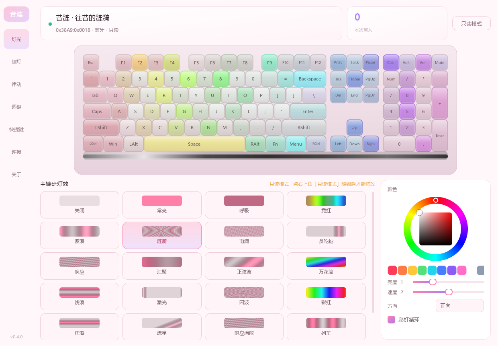
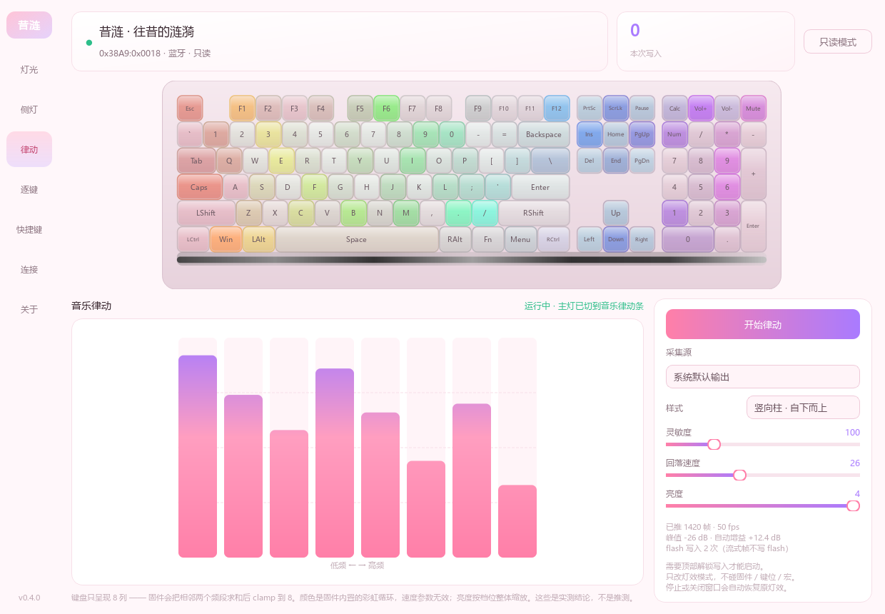
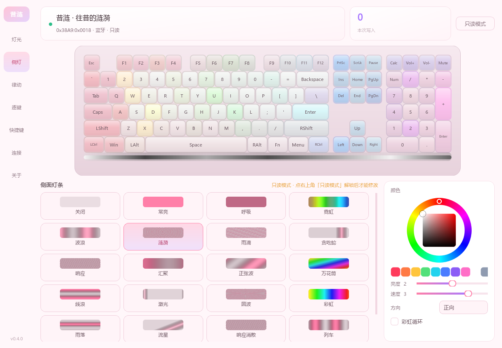
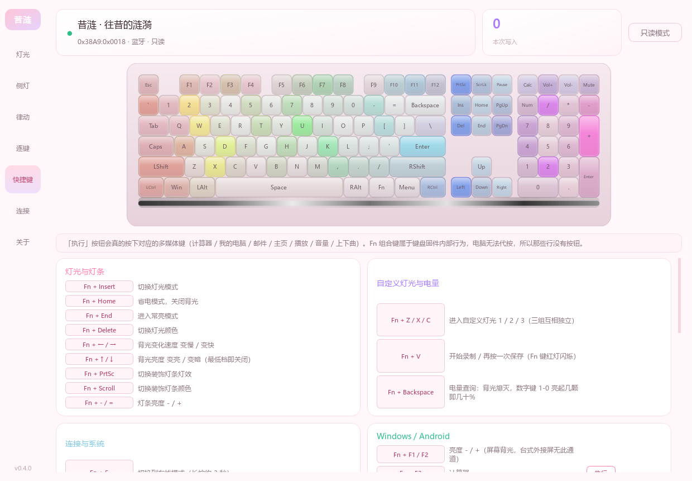

# Cyrene Keyboard · 昔涟键盘控制台

**把键盘上的灯效，搬到桌面上点。**

给「崩坏:星穹铁道」昔涟 · 往昔的涟漪 108 键三模键盘做的 Windows 控制程序。
不用记 Fn 组合键，不用装厂商驱动，插上就能调。

---

## ✨ 能做什么

| | |
|---|---|
| **26 种灯效随便点** | 涟漪、流星、彩虹、贪吃蛇、列车、烟花……点一下就换，键盘图实时预览 |
| **亮度 / 速度 / 方向 / 颜色** | 全部可调，色轮取色 + 10 个预设色块 |
| **侧面灯条独立控制** | 主键区和侧灯条各调各的，互不干扰 |
| **音乐律动** | 让键盘跟着你放的音乐跳，8 列音柱实时响应 |
| **快捷键速查** | 说明书里那堆 Fn 组合键整理成表，多媒体键还能直接点执行 |
| **托盘常驻** | 关窗口缩到托盘，右键快速切灯效 |
| **默认只读** | 打开时不向键盘写任何东西，要改灯得手动解锁并二次确认 |

---

## 🎵 音乐律动

整个软件最有意思的功能：**抓系统正在播放的声音，实时变成键盘上的音柱。**

用 WASAPI 回环采集（不需要开「立体声混音」、不独占设备、不影响你听歌），
做完 FFT 分成 8 个频段，再推给键盘渲染。

**实际用起来需要知道的：**

- **只有 8 列，不是 16 根细柱** —— 这是键盘固件决定的渲染方式，软件改不了
- **颜色是固件内置的彩虹循环**，本协议下无法自定义
- **延迟约 130ms**，听歌够用，卡点视频对不上
- **自带自动增益**：扬声器和蓝牙耳机的回环电平能差 16 倍，程序会自己跟着调
- 采集源可选，选错了会提示（比如选成虚拟声卡，抓到的是别的程序灌进去的声音）

> 💡 **打游戏、录视频时**：建议插 USB 线，有线能跑满 50Hz，灯跟得更紧。
> 蓝牙下默认 25Hz、也可以手动切 50Hz，带宽窄一点，但只听歌看灯完全够用。

---

## 📥 下载安装

到 **[Releases](../../releases/latest)** 页面下载 `CyreneKeyboard-Portable-v*.zip`，
解压后双击 **`双击启动.vbs`**。

- **免安装**：不写注册表、不改系统设置，删掉文件夹就是卸载
- **不用装 Python**：包里自带运行环境
- 万一没反应，改用 `如果打不开点我.bat`，那个窗口里能看到报错
- 首次启动默认**只读模式**，要调灯效点右上角解锁

---

## 🔌 三种连接

| 连接 | 调灯效 | 音乐律动 | 建议 |
|---|---|---|---|
| **USB 有线** | ✅ | ✅ 50Hz | 调灯、玩律动就用它 |
| **蓝牙** | ✅ | ✅ 默认 25Hz | 日常无线，也能调灯 |
| **2.4G 无线** | ❌ | ❌ | 只适合打字 |

蓝牙和有线都能调灯，**2.4G 接收器不行** —— 它只转发按键，不转发灯效指令。
这是接收器固件的设计，不是软件的问题。想调灯就插线，或者切到蓝牙。

---

## 🎨 其他页面

---

## ❓ 常见问题

**Q：为什么给的是 vbs + 文件夹，不是 exe？**
exe 没有代码签名，Windows 11 的「智能应用控制」会直接拦下，而且**用户没法单独放行这一个文件**。
便携版借 Python 官方带签名的解释器当启动器，绕开了这道门。而且不用装、删了就干净。

**Q：2.4G 下为什么调不了灯？**
接收器只做按键透传，这是它固件决定的，各种办法都试过，不通。

**Q：能看电量吗？**
按键盘 `Fn + Backspace`，数字键 1-0 亮起几颗就是几十%。软件里不显示电量 ——
三种连接里两种给不出准确读数，摆个数字反而误导。

**Q：自定义灯光怎么录？**
`Fn + Z`（或 `X` / `C`）进入模式 → 按 `Fn + V` 开始录制（**Fn 键亮红灯闪**）→
逐个按要亮的键 → 再按 `Fn + V` 保存（红灯停止闪）。软件「逐键」页里有完整图文。

**Q：会不会动我的键盘固件？**
不会。只发灯效参数，不刷固件、不改键、不写宏、不动配对。
固件升级、改键、宏、bootloader 这些命令在代码里是**硬拦截**的。

---

## 声明

**非官方项目**，与米哈游 / 腹灵无任何关联。图标为同人创作，角色版权归 miHoYo 所有，
仅用于个人非商业用途。程序本身不含任何游戏资源，也不会偷偷联网
（除了你主动点「检查更新」）。
