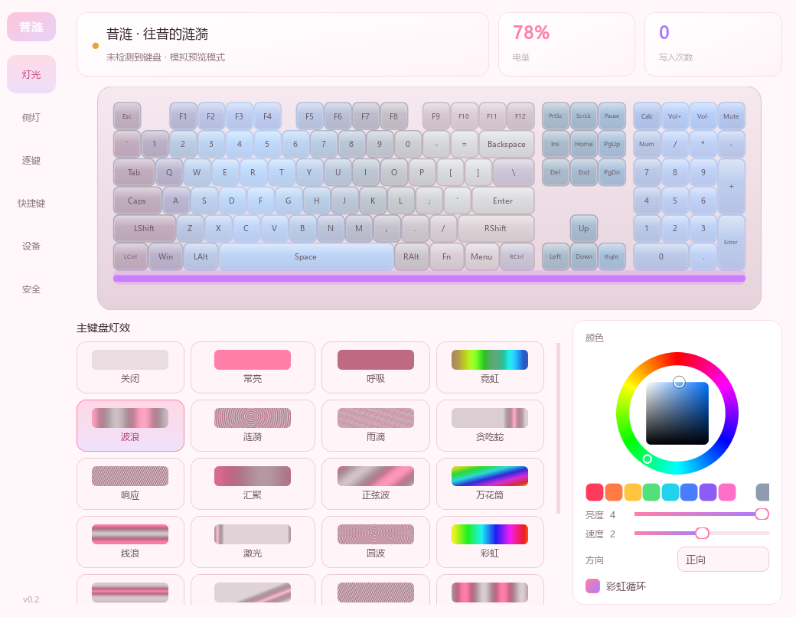

# Cyrene Keyboard · 昔涟键盘控制台

给米哈游「崩坏:星穹铁道」昔涟·往昔的涟漪 108 键三模键盘做的 Windows 控制程序。
把只能在键盘上按的功能搬到桌面：切灯效、调亮度速度方向、侧灯条、音乐律动、托盘常驻。

USB 有线、2.4G 无线、蓝牙三种连接都实测过，能力和限制见「连接方式对比」。



> **非官方项目**，与米哈游 / 腹灵无任何关联。图标为同人创作，角色版权归 miHoYo 所有，
> 仅用于个人非商业用途。程序本身不含任何游戏资源。

## 下载安装

到 **[Releases](../../releases/latest)** 页面下载 `CyreneKeyboard-Portable-v*.zip`，
解压后双击 **`双击启动.vbs`**。

- **免安装**：不写注册表、不改系统设置，删掉文件夹就是卸载
- **不用装 Python**：包里自带运行环境
- 万一没反应，改用 `如果打不开点我.bat`，那个窗口里能看到报错
- 首次启动默认是**只读模式**，不会向键盘写任何东西；要调灯效需点右上角解锁并二次确认

> 为什么不是 exe：PyInstaller 打的 exe 没有代码签名，Windows 的 Smart App Control
> 会直接拦下且**无法为单个文件放行**。便携版借 Python 官方带签名的解释器当启动器，绕开了这道门。

## 三种连接各能干什么

| 连接 | 读灯效 | 改灯效 | 音乐律动 | 适合 |
|---|---|---|---|---|
| **USB 有线** | ✅ | ✅ | ✅ 50Hz | 调灯效、玩律动 |
| **蓝牙** | ✅ | ✅ | ✅ 默认 25Hz，可选 50Hz | 日常无线，也能调灯 |
| **2.4G（dongle）** | ❌ | ❌ | ❌ | 只适合打字 |

**2.4G 为什么不行**：接收器是独立固件，只转发键盘输入报告和它自己的电量查询，
厂商配置报告一律丢弃（传输层、Report ID、接口、跨接口收发、长等待全试过，
缓存一次都没更新）。**蓝牙为什么行**：蓝牙是电脑直连键盘，中间没有那颗接收器芯片。

不知道自己当前这条链路能不能配置，跑一条命令就知道：

```bash
python tools/probe_link.py
```

## 硬件身份（已实测确证）

| 项 | 值 |
|---|---|
| 代工厂 | 腹灵 FL·ESPORTS（平台等同 NX98 Pro） |
| VID / PID | **`0x38A9`/`0x0017`** = USB 有线（可配置）；**`0x38A9`/`0x0018`** = 蓝牙（可配置）；**`0x3151`/`0x5052`** = 2.4G 无线（不转发配置命令） |
| 设备名 | `Air 108 metallic`（蓝牙下固件报的是 `Model_Number`，所以程序**从不按名字识别设备**） |
| 厂商接口 | USB / 2.4G：`itf=2, usagePage=0xFFFF, usage=0x02`；蓝牙：`usagePage=0xFF55, usage=0x0202` |
| 主控平台 | 容源 rongyuan **RY6609**（官方升级工具的设备表确认） |
| 同平台兄弟 | AKKO、MonsGeek、黑爵、腹灵、ikbc —— 共用一套 SDK |
| 通信 | USB/2.4G：HID Feature Report，Report ID 0；蓝牙：Output Report（Report ID 6）+ `0x55` 前导，响应走 Input 通知 |
| 驱动需求 | **无**。纯用户态 HID，不装内核驱动 |

判断依据：腹灵官网驱动页（`flesports.com/?p=514`）的适配型号列表里明确列着
「崩坏:星穹铁道」昔涟·往昔的涟漪；本机注册表读到 `VID_3151&PID_5052`；
腹灵官方在线驱动 `iotdriver.qmk.top` 的前端资源里大量出现 `yc3121_*` 固件标识；
该驱动的 protobuf 定义里有 `Device.battery`、`Status24{battery,isOnline}`，证明固件支持上报电量。

## 界面设计

参考 Razer Synapse / 罗技 G HUB / 海盗船 iCUE / Keychron Launcher 的共同思路，
配色直接取自键盘实物（左侧樱粉、中间奶白、右侧淡蓝）：

1. **键盘本体是视觉主体** —— 108 键俯视图用 QPainter 矢量绘制，键帽按实物分区上色
   （F 区/左侧功能列粉、主键区白、编辑区与方向键淡蓝、数字区粉白、媒体键淡紫）。
   灯效实时渲染：暗处保持键帽本色，亮处叠上灯效色，缝隙溢光强化灯效流动感。不是贴图，任意缩放都清晰。
2. **浅色樱粉主题** —— 底色 `#FFF7FA`，主色 `#FF7FA8`（樱粉）→ `#A97BFF`（薰衣草紫）。
   浅色底上灯效会弱一些，所以渲染策略改成「白键帽 + 缝彩溢光」而不是深色底的加色发光。
3. **左侧图标导航 + 顶部状态卡 + 设备预览 + 底部控制区**，大厂驱动的标准四段式。
4. **每个灯效模式自带预览小图** —— 逐像素采样该模式的灯效函数，浅底上按亮度叠加，直接画出它长什么样。
5. **通道联动** —— 切到「侧灯」页时，键帽自动压暗、底部灯条高亮，视线自然落到当前在调的那一路。
6. **色轮取色器** —— 外环选色相、内方块选饱和度/明度，配一排预设色块。
7. **快捷键速查页** —— 把说明书里的 FN 组合键（灯光/连接/多媒体/双系统）整成对照表。

## 真机实测结果（2026-10-24，USB 有线，全程只读）

| 命令 | 结果 | 读到的值 |
|---|---|---|
| `0x87` GET_LEDPARAM | ✅ 稳定可读 | `05 02 04 08 FF FF FF` → 涟漪 / 速度2 / 亮度4 / 彩虹循环 |
| `0x88` GET_SLEDPARAM | ✅ 稳定可读 | `01 03 04 07 FF FF FF` → 常亮 / 速度3 / 亮度4 / 单色白 |
| `0x86` GET_DEBOUNCE | ✅ | `01` → 去抖 1ms |
| `0x90` GET_FN | ✅ | `0A 02` |
| `0x8A` GET_KEYMATRIX | ✅ 部分 | 需分块读，首块有数据 |
| `0x8F` GET_USB_VERSION | ✅ | `10 10 ... 04 01` |
| `0x91` GET_SLEEPTIME | ✅ | `78 00 78 00 58 02 58 02` → 120s / 600s |
| `0x83` GET_BATTERY | ❌ 回显 | 试了 6 种参数，全部原样回显，**该固件不支持** |
| `0xF7` GET_DONGLE_STATUS | ⚠ 有线回显 | **仅 2.4G 接收器本地应答**，能读到电量+充电状态 |
| `0x80/0x84/0x85/0x89/0x8C/0x97/0xE6` | ❌ 回显 | 未实现 |

### 写入通道（已实测打通）

`SET_LEDPARAM (0x07)` 三种候选帧格式逐一实测，只有一种生效：

| 格式 | 布局 | 结果 |
|---|---|---|
| A | 7 参数占 `frame[2..8]`，校验和放 `frame[9]` = `255-sum(frame[1:9])` | ✅ **生效** |
| B | 7 参数占 `frame[2..8]`，不带校验和 | ❌ 无反应 |
| C | 6 参数（省略 B），校验和放 `frame[8]` | 未测（会丢蓝色通道） |

**关键结论：GET 和 SET 的校验和位置不同。**

| | 参数区 | 校验和位置 | 算法 |
|---|---|---|---|
| GET 查询（0x87/0x88） | 无 | `frame[8]` | `255 - sum(frame[0:8])` |
| SET 灯效（0x07/0x08） | `frame[2..8]` | `frame[9]` | `255 - sum(frame[1:9])` |

混用会直接失败：把 GET 的校验和挪到 `frame[9]`，键盘立刻停止返回数据、改为原样回显。
这个现象反过来成了验证手段 —— 能用来确认某个位置对不对。

验证过程：只把亮度 4→3，写完读回确认变成 3，再写回 4 读回确认恢复。
完整链路（UI → backend → safety → HID）已跑通，统计 `读 3 次 / 写 2 次`。

**判定「真实响应 vs 回显」的方法**：请求帧只有命令码和参数、其余全零；若响应与请求逐字节相同，
说明固件没实现该命令、把请求原样回显。这个判断必须做，否则会把回显的 `00` 当成「电量 0%」。

**电量**：界面已不再显示（2026-10-25 移除）。USB 模式下固件不提供电量查询；
蓝牙下厂商命令也读不到；只有 2.4G 接收器会本地应答一个数值。既然三种连接里两种给不出准确值，
摆一个数字只会误导 —— 想看电量请按键盘 `Fn + Backspace`（数字键 1-0 亮起几颗 = 几十%），
那是固件本地行为，不经过 HID 查询通道，反而最准。
说明书早期版本里写的 `Fn+右Shift` 是错的，正确的是 `Fn+Backspace`。

## 只读保护（三重）+ 解锁开关

默认打开软件就是**只读**，顶栏右侧有「只读模式」按钮。
点一下弹二次确认，确认后才解锁写入；再点一下可立即锁回。

调协议时最怕手滑改坏键盘配置，所以做了三层，任一层独立生效：

1. **`SafetyPolicy.strict_readonly`** —— 非查询命令直接抛异常，连发都不发
2. **`Keyboard.readonly`** —— 底层 `send()` 再拦一道，非 `READ_ONLY` 的帧**出不了本机**
3. **`EffectsPage.readonly`** —— 界面控件变化只更新 UI，不触发回写，只读时连拖动滑块都不会发帧

实测统计一直是 `写 0 次 / 拦截 0 次`，说明连「尝试写」都没发生过。
另外 `0xAD`/`0xAE` 两条没列进白名单的查询命令被第 1 层拦下，证明锁是活的、不是摆设。

## 说明书给到的关键情报

| 情报 | 影响 |
|---|---|
| `Fn + Backspace` 查电量，数字键 1-0 亮起几颗即几十% | 证明固件有真实电量值（10% 步进），但 `0x83` 六种参数全回显，该固件不开放 |
| `Fn+Z`/`Fn+X`/`Fn+C` 进自定义灯光 1/2/3，`Fn+V` 录制保存，**按任意键点亮该键** | 固件内部本就有「物理键 → LED」映射，但颜色读不回，故不做盲写 |
| `Fn+PrtSc` 切灯条灯效、`Fn+Scroll` 切灯条颜色、`Fn+-`/`Fn+=` 调灯条亮度 | 侧面灯条确实是独立通道，`SLEDPARAM` 设计正确 |

> ⚠ 早期版本这里写过 `Fn+右Shift` / `Fn+Enter` / `Fn+右Alt`，那是按「常见键盘惯例」猜的，
> 对照说明书后确认**全错**。以本表为准。

## 功能边界（重要）

这个软件的定位是**只动外观，不动键盘本体**。

### 会做

| 功能 | 说明 |
|---|---|
| 灯效模式切换 | 26 个编号中的 **21 种**（逐键/GIF/音乐/屏幕同步不在灯效页；音乐在独立「律动」页） |
| 亮度 / 速度 / 方向 | 0-4 档 |
| 单色 / 彩虹循环 | 色轮 + 预设色块 |
| 侧面灯条 | 与主键盘独立的通道，独立参数（`SET_SLEDPARAM` 已实测可用） |
| 音乐律动 | 抓系统声音（WASAPI 回环）→ 8 频带 → 键盘 8 列柱状跟随。有线 50Hz，蓝牙可选 25/50Hz |
| 托盘常驻 | 双击恢复窗口，右键快捷切灯效 |

> 电量**不在界面显示**（2026-10-25 移除）。三种连接没一种能给准确读数：
> USB 固件不响应查询、蓝牙厂商命令读不到、2.4G 能读但没必要。
> 想看电量按键盘 `Fn + Backspace` —— 那是固件本地行为，比软件读的准。

### 永远不做

这六条不是"暂时不做"，是**默认拒绝原则**下被代码硬拦的：

| 命令 | 为什么不做 |
|---|---|
| `0x7F` `0x30` `0x31` 固件升级 / bootloader | 刷坏即变砖 |
| `0x01` 恢复出厂设置 | 会清空全部自定义配置 |
| `0x0A` `0x0B` `0x10` 改键 / 宏 / Fn 层 | **该固件对参数不做越界检查**，传超范围值会写坏 RAM，`macro_id>=16` 甚至能覆盖栈返回地址 |
| `0xF8` `0x7A` 配对控制 | 会断开当前连接 |
| `0x65` `0x1B` `0x1C` `0x1E` 磁轴命令 | 本键盘是机械轴，无意义 |
| 任何不在白名单里的未知命令 | 默认拒绝 |

实现位置：`kb/safety.py` 的 `FORBIDDEN` 字典 + `SafetyPolicy.assert_allowed()`。
所有收发都只能走 `HidBackend._query` / `_send` 这两个出口，都要先过这道闸。

### 唯一认下的真实风险：flash 磨损

灯效设置会触发固件写 flash（键盘设计如此，官方驱动一样做）。拖滑块时每次变化都发一帧，
一次调色可能写几百次。所以加了两道闸：

1. **值没变不发** —— 相同参数不重复下发
2. **同一命令 350ms 内只发一次** —— 拖动过程合并，松手后只落一帧

界面上实时显示「写入次数 / 跳过重复值」，这是可验证的，不是嘴上保证。

## 连接方式对比（技术细节）

能力差异的结论在开头「三种连接各能干什么」已经列了，这里只补两条原理和实测口径：

- **2.4G 的不转发是穷举过的**：Feature Report / Output Report × `itf=1`/`itf=2` ×
  跨接口收发 × Report ID `0/1/2/5/6` × 有无 `0x55` 前导 × 等 0.5/2/4 秒，
  接收器的缓存槽一次都没更新。工具留在 `tools/probe_24g_deep.py`、`probe_24g_wake.py`。
- **蓝牙是直连**：`38A9:0018`，走 GATT/HOGP 的 Output Report（Report ID 6）+ `0x55` 前导，
  响应走 Input Report 通知。和 USB 是两套传输层，但**参数区逐字节相同**。

延迟实测：USB 一轮约 1ms；蓝牙单帧 16ms（= BLE 连接间隔，上限约 64Hz）。

## 协议要点

- **帧布局**：`frame[0]=ReportID(0)`、`frame[1]=CMD`、`frame[2..]=参数`
- **校验和 Bit7**（多数命令）：`frame[7] = 255 - (sum(frame[0..6]) & 0xFF)`
- **校验和 Bit8**（LED 命令 0x07/0x08）：`frame[8] = 255 - (sum(frame[0..7]) & 0xFF)`
- **读**：先 `send_feature_report` 发查询帧，再 `get_feature_report` 取响应
- 响应 `frame[1] == 0xAA` 表示成功

### 关键命令

| CMD | 名称 | 用途 |
|---|---|---|
| `0x07` / `0x87` | SET/GET_LEDPARAM | 灯效模式、速度、亮度、方向、颜色 |
| `0x08` / `0x88` | SET/GET_SLEDPARAM | 侧面灯条 |
| `0x0C` / `0x8C` | SET/GET_USERPIC | 逐键 RGB 静态颜色（模式 13） |
| `0x83` | GET_BATTERY(有线) | 电量，语义待实测确认 |
| `0xF7` | GET_DONGLE_STATUS | 2.4G 下取电量 |

26 种灯效模式表见 `kb/protocol.py` 的 `LED_MODES`。

## 目录结构

```
main.py              入口（--mock 强制模拟 / --probe 只做真机探测）
kb/
  protocol.py        命令码、校验和、报文构造、灯效表
  device.py          设备发现、Feature Report 封装
  safety.py          命令白名单 + 危险命令硬拦截 + 写限流
  backend.py         后端抽象 + HidBackend + MockBackend
ui/
  theme.py           深色主题与设计令牌
  layout_data.py     108 键布局坐标（22.5u × 6u）
  keyboard_view.py   键盘可视化 + 灯效渲染引擎
  colorwheel.py      HSV 色轮 + 预设色块
  app.py             主窗口、六个页面、托盘、快捷键速查
tools/
  probe_readonly.py  严格只读探测（三重锁，只发 GET）
  probe_round2.py    扩范围只读探测 + 回显判定
  probe_input.py     监听厂商接口 input report（纯读，找电量上报）
  render_live.py     用真机（只读）渲染界面截图
  probe_live.py      真机探测：确认接口 + 逐条试 GET 命令
  smoke_test.py      无界面冒烟测试（协议/安全/后端/界面）
  render_preview.py  渲染整窗预览图
  render_keyboard.py 单独渲染键盘视图（调色用）
  build.py           打包单文件 exe
  list_all_hid.py    列出在线 HID 接口
  enum_hid_reg.py    走注册表枚举历史设备
  analyze_iot.py     解析腹灵在线驱动 JS 里的 PID 表
```

## 运行

### 普通用户（不想装 Python）

下载 `XilianKeyboard-Portable-v0.4.0.zip`，解压，双击 **`双击启动.vbs`**。

- 不需要装 Python，不写注册表，删掉文件夹就是卸载
- 万一没反应，改用 `如果打不开点我.bat`，那个窗口里能看到报错
- 为什么不是 exe：PyInstaller 打出来的 exe 没有代码签名，Windows 的
  **Smart App Control** 会直接拦下且**无法为单个文件放行**。便携版借 Python 官方
  带签名的 `python.exe` 当启动器，绕开了这道门

### 开发者

```bash
python main.py            # 正常启动（自动连真机，默认只读）
python main.py --mock     # 强制模拟模式，完全不碰硬件
python main.py --probe    # 只做真机探测，不开界面
```

自检（三条都应该全绿）：

```bash
python tools/smoke_test.py         # 协议 / 安全 / 后端 / 界面构造
python tools/test_audioviz.py      # 音频引擎（合成扫频）
python tools/test_music_page.py    # 律动页全流程（offscreen，不碰真机）
```

打包便携版：

```bash
python tools/build_portable.py     # 重新组装 + 生成 dist/…zip
```

## 当前进度

- [x] 确认硬件身份与协议平台（RY6609）
- [x] 拿到命令表与校验和算法（**GET 在 `frame[8]`、SET 在 `frame[9]`，位置不同**）
- [x] 安全策略层（白名单 + 14 条危险命令硬拦截 + 写限流 + 流式单列限流）
- [x] 后端抽象 + 模拟后端（无硬件可开发）
- [x] 键盘可视化渲染引擎（108 键矢量绘制 + 18 种灯效动画）
- [x] 浅色樱粉主题（配色取自键盘实物）+ 键帽分区上色
- [x] 快捷键速查页（严格对照说明书）+ 多媒体键可点执行
- [x] 真机探测：通信打通，灯效读写稳定
- [x] 只读锁 + 二次确认解锁 UI
- [x] **21 个灯效编号逐个验证全被固件接受**
- [x] **音乐律动**：0x0D 帧格式打通（不写 flash）、WASAPI 回环采集、8 频带 + 自动增益
- [x] **2.4G 实测确认不转发配置**（传输层 / Report ID / 接口 / 跨接口全穷举过）
- [x] **蓝牙实测可读可写**（`0x55` 前导 + Report ID 6，2026-10-25）
- [x] **蓝牙律动**：默认 25Hz，可选 50Hz
- [x] 识别兜底：VID/PID 不认识时按 usage 签名自动发现（方便别人用）
- [x] 检查版本更新（GitHub Releases，只在点击时联网一次）
- [x] 绿色便携版（Python embeddable，绕开 Smart App Control）
- [ ] 灯效名与视觉效果逐个肉眼核对（编号已验证，名字抄自协议文档）
- [ ] 逐键 RGB 键位索引映射（固件不支持读回，已决定不做）

## 逐键 RGB 为什么不由软件做

固件不支持读回逐键颜色 —— 查询 `0x8C GET_USERPIC` 无论带什么参数都原样回显。
这意味着写完无法验证，只能靠眼睛看；而 108 个键在固件里的索引又完全未知，
盲写错位就会出现「点 A 亮 B」，比键盘自带的录制方式更容易出错。

所以软件里保留键盘原生做法，并在「逐键」页写成 4 步（**按说明书原文**）：

1. `Fn + Z`（或 `Fn + X` / `Fn + C`）进入自定义灯光模式 1 / 2 / 3
2. `Fn + V` 开始录制 —— **Fn 键亮红灯并闪烁**（闪的是 Fn 键，不是整把键盘的背光）
3. 逐个按要亮的键，按一个亮一个
4. 再按 `Fn + V` 保存，Fn 键停止闪烁

## 已知待办

1. **灯效名 ↔ 视觉效果**：21 个编号都被固件接受，但"流星像不像流星"只能靠眼睛。
   不符就改 `kb/protocol.py` 的 `LED_MODES` 文案，不影响协议。
2. **蓝牙电量**：标准 BLE Battery Service（`0x180F`）里有，`hidapi` 够不着。
   要读得另用 WinRT / `bleak`，暂不做。
3. **律动延迟补偿**：音频到灯固定约 130ms（驱动端点缓冲 87ms 占大头），
   娱乐够用，卡点视频对不上。
